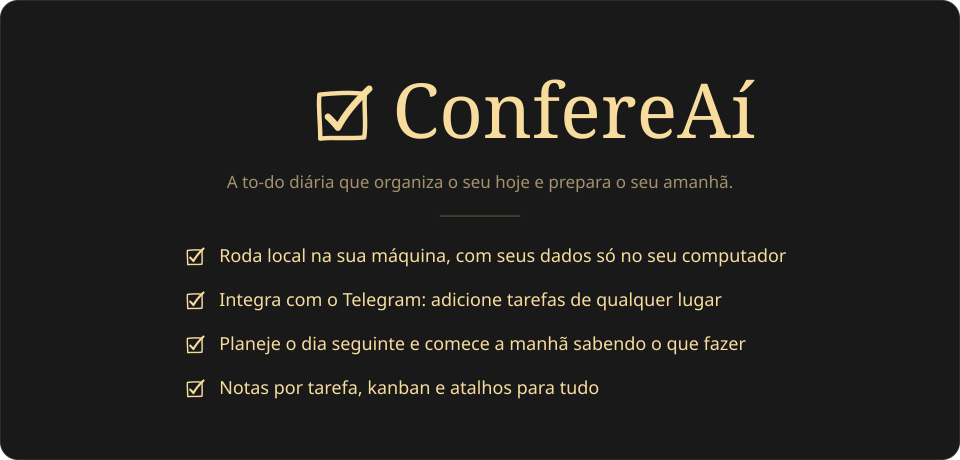
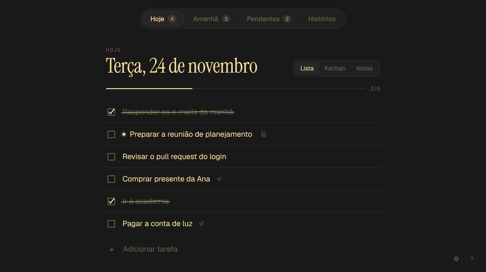
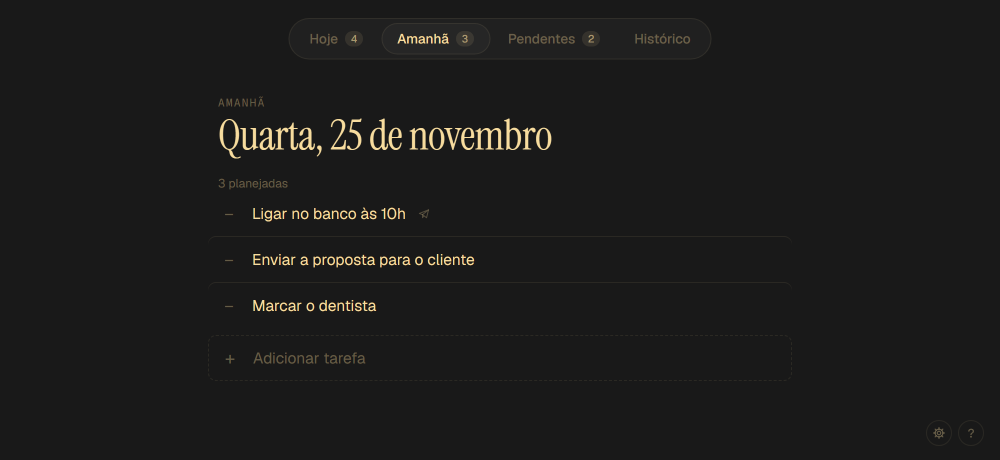
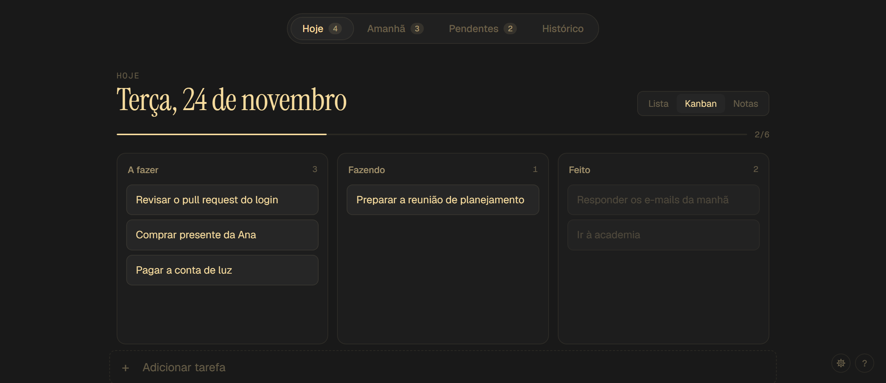
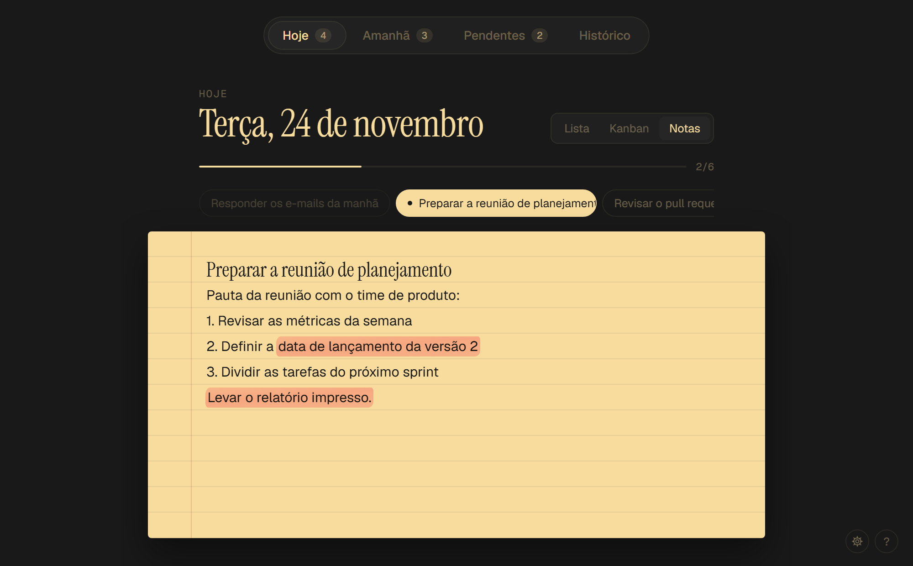
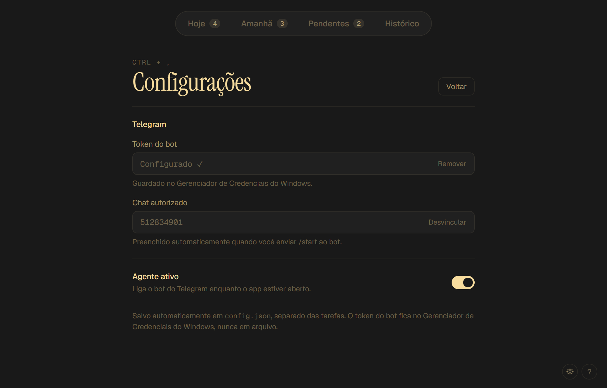
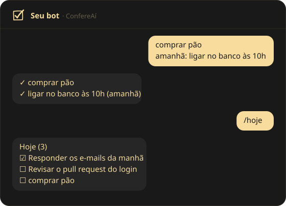

<p align="center">
  
</p>

<p align="center">
  <a href="https://github.com/pedroatilagc/confere-ai/releases/latest/download/ConfereAi-setup.exe">
    
  </a>
</p>

<p align="center">
  <sub>Windows 10 e 11 · instalação por usuário, sem pedir administrador · gratuito e open source (MIT)</sub>
</p>

<br>

<p align="center">
  
</p>

O **ConfereAí** é uma lista de tarefas diária, feita para quem quer terminar o dia com a sensação de dever cumprido. Ele vive no seu computador, abre junto com o Windows e mostra só o que importa: **o que fazer hoje** e **o que já está planejado para amanhã**.

E quando a ideia aparece longe do PC, no ônibus, no mercado ou no meio de uma reunião, é só mandar uma mensagem para o **seu bot no Telegram**. A tarefa aparece no app na hora.

## Por que planejar o dia seguinte

Quem fecha o dia anotando as tarefas de amanhã começa a manhã **decidindo menos e fazendo mais**. Você não precisa lembrar de tudo; só precisa abrir o app.

- **Menos carga mental:** o que ficou para amanhã sai da cabeça e vai para a lista. Dá para desligar de verdade no fim do dia.
- **Manhãs com direção:** em vez de "por onde eu começo?", a lista de hoje já está pronta esperando você.
- **Foco no que é de hoje:** tarefas de amanhã ficam separadas e não podem ser concluídas antes da hora. O que é de hoje é de hoje.
- **Nada se perde:** o que não deu tempo vai para **Pendentes**, e com um clique volta para hoje.

<p align="center">
  
  <br><sub>A aba <b>Amanhã</b>: o dia seguinte planejado antes de você desligar o computador.</sub>
</p>

## O que ele faz

| | |
|---|---|
| **Hoje** | Sua lista do dia, com arrastar e soltar para reordenar. Alterne entre **lista**, **kanban** (a fazer, fazendo, feito) e **notas**. |
| **Amanhã** | O planejamento do dia seguinte. Na virada da meia-noite, essas tarefas viram as de hoje. |
| **Pendentes** | O que ficou para trás nos últimos 7 dias, pronto para ser trazido de volta. |
| **Histórico** | Os últimos 7 dias, dia a dia, com o que foi feito e o que ficou. |
| **Notas por tarefa** | Cada tarefa pode ter uma folha de anotações, com marca-texto. |
| **Bot do Telegram** | Adicione tarefas e consulte o dia pelo celular, de qualquer lugar. |
| **Teclado primeiro** | Tudo tem atalho. Aperte `?` dentro do app para ver a lista. |

### Três jeitos de ver o seu dia

**Kanban:** arraste as tarefas entre *A fazer*, *Fazendo* e *Feito*.

<p align="center">
  
</p>

**Notas:** cada tarefa ganha uma folha pautada para pautas, checklists e lembretes, com marca-texto para o que não pode passar.

<p align="center">
  
</p>

## Instalação

1. Baixe o instalador pelo botão acima ou em **[Releases](https://github.com/pedroatilagc/confere-ai/releases/latest)** (`ConfereAi-setup.exe`).
2. Execute. O instalador é por usuário e não pede permissão de administrador.
   - Se o Windows SmartScreen avisar que o app é desconhecido, clique em **Mais informações → Executar assim mesmo**. O aviso aparece porque o instalador não tem assinatura digital paga; o código está todo aqui no repositório.
3. Pronto. O ConfereAí passa a abrir sozinho quando você liga o computador.

**Para não abrir com o Windows:** Gerenciador de Tarefas → *Aplicativos de inicialização* → ConfereAí → *Desabilitar*.

## Como usar

- **Criar uma tarefa:** aperte `N`, digite e dê `Enter`.
- **Concluir:** clique na caixinha ou aperte `Espaço` com a tarefa selecionada.
- **Planejar amanhã:** abra a aba **Amanhã** (`Ctrl+2`) e crie as tarefas lá.
- **Anotar:** no menu `⋯` da tarefa, escolha **Notas**. Selecione um trecho e use `Ctrl+Shift+H` para grifar.
- **Trocar a visualização de hoje:** `Ctrl+K` alterna entre lista, kanban e notas.

### Atalhos

| Atalho | Ação |
|---|---|
| `Ctrl+1` … `Ctrl+4` | Hoje · Amanhã · Pendentes · Histórico |
| `Ctrl+K` | Alternar lista, kanban e notas |
| `Ctrl+,` | Configurações |
| `N` | Nova tarefa |
| `↑` `↓` | Andar entre as tarefas |
| `Espaço` | Concluir ou reabrir |
| `Enter` · `F2` | Editar |
| `Delete` | Apagar |
| `Ctrl+Shift+H` | Grifar texto na nota |
| `?` | Mostrar os atalhos |
| `Esc` | Cancelar ou fechar |

## Bot do Telegram

Com o bot, você adiciona tarefas pelo celular e consulta o seu dia de onde estiver. Ele **não depende de servidor**: o próprio app, aberto no seu PC, busca as mensagens do bot.

### Configurar (uma vez, cerca de 2 minutos)

1. No Telegram, abra o **[@BotFather](https://t.me/BotFather)** e envie `/newbot`.
2. Escolha um nome e um usuário terminado em `bot`. O BotFather responde com um **token**.
3. No ConfereAí, abra as **Configurações** (`Ctrl+,` ou a engrenagem no canto inferior direito), cole o token e clique em **Salvar**.
4. Ligue **Agente ativo**.
5. Envie `/start` para o seu bot. Esse chat passa a ser o único autorizado.

<p align="center">
  
  <br><sub>Configurações prontas: token guardado, chat autorizado e agente ligado.</sub>
</p>

> **Cada pessoa usa o próprio bot.** O Telegram só deixa um programa ler as mensagens de um bot por vez, e o token dá acesso total a ele. Por isso o ConfereAí não tem um bot compartilhado: cada instalação conversa com o bot do seu dono.

### Usar

| Você envia | O que acontece |
|---|---|
| `comprar pão` | Tarefa adicionada em **hoje** |
| `amanhã: ligar no banco` | Tarefa adicionada em **amanhã** |
| várias linhas | Uma tarefa por linha |
| `/hoje` | Lista as tarefas de hoje (☑ concluída, ☐ em aberto) |
| `/amanha` | Lista as tarefas de amanhã |

<p align="center">
  
</p>

As tarefas que chegam pelo bot aparecem no app com um pequeno aviãozinho de papel, para você saber de onde vieram.

O bot confirma cada tarefa com ✓ ou explica com ✗ por que ela não entrou (por exemplo, um texto com mais de 280 caracteres).

**Opcional:** para os comandos aparecerem no menu `/` do Telegram, envie `/setcommands` ao BotFather, escolha o seu bot e mande:

```
hoje - Tarefas de hoje
amanha - Tarefas de amanhã
```

**Importante:** o bot funciona enquanto o app está aberto, mesmo que minimizado. Mensagens enviadas com o app fechado não se perdem: elas chegam quando ele abrir de novo (o Telegram guarda as mensagens por até 24 horas).

## Privacidade e segurança

- **Seus dados ficam no seu computador.** Não existe conta, nuvem nem telemetria.
- **O token do bot fica no Gerenciador de Credenciais do Windows**, criptografado com o seu login, e nunca é gravado em arquivo.
- **A única conexão externa é com `api.telegram.org`**, e só quando o agente está ligado. A interface do app não tem acesso à internet.
- **Só o seu chat é ouvido.** Mensagens de qualquer outro chat são ignoradas.
- **As mensagens passam pelo Telegram.** Conversas com bots não têm criptografia de ponta a ponta, então vale o mesmo cuidado de qualquer chat do Telegram.

### Onde ficam os dados

Em `%APPDATA%\com.confereai.app\`:

- `tasks.json`: tarefas e notas. Tarefas com mais de 7 dias são apagadas automaticamente, junto com as notas.
- `config.json`: preferências do agente (se está ligado e qual chat é o autorizado). Não guarda segredos.

São arquivos JSON legíveis. Para fazer backup, basta copiar a pasta.

## Para desenvolvedores

### Stack

[Tauri 2](https://tauri.app) (Rust) · React 19 · TypeScript · Vite · TipTap (notas) · dnd-kit (arrastar e soltar) · `tauri-plugin-store` · `reqwest` + `tokio` (bot) · `keyring` (Gerenciador de Credenciais).

### Rodar e compilar

Pré-requisitos: [Node.js](https://nodejs.org) 20+, [Rust](https://rustup.rs) e os [pré-requisitos do Tauri para Windows](https://tauri.app/start/prerequisites/) (WebView2 e Build Tools do Visual Studio).

```bash
npm install
npm run tauri dev     # janela com hot-reload (sem autostart)
npm run tauri build   # gera o instalador
```

O instalador sai em `src-tauri/target/release/bundle/nsis/`.

### Arquitetura

```
src/
  lib/tasks.ts        regras de negócio em funções puras, usadas pela interface e pelo bot
  lib/storage.ts      tasks.json, com versão de formato e migração
  lib/config.ts       config.json (preferências do agente)
  state/              estado das tarefas e a escuta dos eventos do bot
  components/, views/ interface
src-tauri/src/
  lib.rs              plugins e comandos
  telegram.rs         long polling do bot, /start, /hoje, /amanha e respostas
  secrets.rs          token no Gerenciador de Credenciais
  agent.rs            evento agent://commands
```

Fluxo de uma mensagem do bot:

```
Telegram ──getUpdates (long polling)──> Rust
   ──AgentCommand[]──> evento agent://commands ──> React
   ──> applyCommands (as mesmas regras da interface) ──> tasks.json
   ──resultado──> Rust ──sendMessage──> Telegram (✓ / ✗)
```

- **Uma regra, um lugar:** tudo o que chega do bot é tratado como dado não confiável e passa por `applyCommands` (`src/lib/tasks.ts`), que aplica exatamente as mesmas regras da interface.
- **Segredos fora do JavaScript:** a rede e o token ficam no Rust. A política de segurança (CSP) da interface continua sem acesso externo.
- **Testar sem bot (só em dev):** no DevTools (`Ctrl+Shift+I`), rode
  `__inject([{ type: "add_task", text: "teste", date: "AAAA-MM-DD" }])`.

### Contribuindo

Issues e pull requests são bem-vindos. Use [Conventional Commits](https://www.conventionalcommits.org/pt-br/) nas mensagens (`feat:`, `fix:`, `docs:` …).

## Licença

[MIT](LICENSE) © pedroatilagc
